# 🚀 Awesome-AI-Powered-Terminal-Developer-CLI

 

 

### ⚡ Curated Directory of AI-Native Terminals, Autonomous CLI Coding Agents & Developer Copilots

*A comprehensive, star-ranked guide to intelligent terminal emulators, natural language shell wrappers, Model Context Protocol (MCP) coding agents, and terminal DevOps assistants.*

**Last updated: November 2026**

---

## 🧭 Table of Contents

- [🌐 Sector Overview & Market Dynamics](#-sector-overview--market-dynamics)
- [💼 SaaS & Hosted Developer Platforms](#-saas--hosted-developer-platforms)
- [⭐ Open-Source GitHub Projects](#-open-source-github-projects)
  - [Terminal Coding Agents & Harnesses](#terminal-coding-agents--harnesses)
  - [AI-Native Terminals & Multiplexers](#ai-native-terminals--multiplexers)
  - [Natural Language Shells & Unix Pipes](#natural-language-shells--unix-pipes)
  - [Intelligent Autocomplete & History Search](#intelligent-autocomplete--history-search)
  - [Git, SRE & Kubernetes DevOps Assistants](#git-sre--kubernetes-devops-assistants)
  - [Local AI Inference CLI Engines](#local-ai-inference-cli-engines)
- [🛠 Architectural Stacks for Sovereign AI Terminals](#-architectural-stacks-for-sovereign-ai-terminals)
- [🤝 How to Contribute](#-how-to-contribute)
- [💖 Support](#-support)
- [📈 Star History](#-star-history)
- [⚖ Disclaimer](#-disclaimer)

---

## 🌐 Sector Overview & Market Dynamics

The global AI-assisted developer tools and intelligent terminal ecosystem is estimated at **$12.5 billion in 2026**, projected to exceed **$38 billion by 2030** with an accelerating CAGR of ~32%. The market is **moderately fragmented**: mega-cap hyper-scalers (Microsoft/GitHub, Amazon, Anthropic, Atlassian) dominate enterprise governance and code synthesis distributions, while specialized AI startups (Warp, Tabnine, Termius) and hyper-innovative open-source projects capture rapid developer adoption through Model Context Protocol (MCP) integrations, local offline LLMs, and native terminal-first UX loops.

---

## 💼 SaaS & Hosted Developer Platforms

| Company / Product | Valuation / Revenue | Starting Paid Tier Pricing | Free Tier / Trial Limit | Key Terminal AI Capabilities |
| :--- | :--- | :--- | :--- | :--- |
| **[Amazon Q Developer CLI](https://amazon.com)** (formerly Fig) | **$2.30T Market Cap** (Amazon) | **$19 per user / month** (Pro Tier) | **Free tier forever** with 50 agentic software development task credits/month and standard terminal inline completions | Shell autocomplete, natural language translation to Bash/Zsh, multi-repo codebase updates, and AWS DevOps troubleshooting. |
| **[GitHub Copilot CLI](https://github.com)** | **$3.15T Market Cap** (Microsoft parent) / **$2B+ ARR** (GitHub) | **$10 per user / month** (Copilot Individual) | **30-day free trial** with access to all CLI features and model completions | Official CLI extension explaining shell commands, suggesting Git/gh commands, and managing terminal pull-request workflows. |
| **[Anthropic Claude Code](https://anthropic.com)** | **$60B Valuation** / **$1B+ Run-rate Revenue** | **$20 per user / month** (Claude Pro) or pay-as-you-go via API ($3 / MTok input) | **Free tier forever** on basic Claude.ai web, CLI requires API key ($5 complimentary starting API credits) | Autonomous terminal agent capable of editing multi-file codebases, running bash tests, inspecting git history, and executing MCP tools. |
| **[Atlassian Rovo Dev CLI](https://atlassian.com)** | **$55B Market Cap** (Atlassian) | **$20 per user / month** (Atlassian Cloud add-on) | **30-day free trial** with unlimited developer agent workflows and Jira issue context | Enterprise command-line agent linking local terminal tasks directly with Jira backlogs, Confluence documentation, and Bitbucket pull requests. |
| **[Warp (Warp AI & Oz Agents)](https://warp.dev)** | **$500M+ Valuation** | **$12 per user / month** (Warp Pro) | **Free tier forever** with 150 Warp AI requests per user/month and full modern GPU terminal emulator features | Rust/GPU terminal emulator with AI command prediction, agentic debugging of stack traces, and cloud-synced terminal notebooks. |
| **[Tabnine CLI / BitCLI](https://tabnine.com)** | **$150M+ Valuation** | **$12 per user / month** (Tabnine Pro) | **90-day free trial** of Tabnine Pro (no credit card required), with a forever-free basic snippet autocomplete plan | Enterprise-grade private AI code assistant for terminal command completion with zero code retention and air-gapped deployment support. |
| **[Termius AI](https://termius.com)** | **$50M+ Est. Valuation** / Profitable | **$10 per user / month** (Pro Plan) | **14-day free trial** of Termius Pro with AI commands; forever-free basic SSH client plan | Cross-platform SSH and SFTP terminal workspace with built-in AI terminal command synthesis, error diagnostics, and shared snippet vaults. |
| **[Butterfish](https://butterfish.io)** | **Bootstrapped / Seed** | **$9 per user / month** (Commercial Team Tier) | **Free tier forever** for personal open-source shell integration with local OpenAI/Anthropic API keys | AI shell wrapper embedding persistent LLM state directly into standard Bash and Zsh sessions with context-aware command generation. |

---

## ⭐ Open-Source GitHub Projects

The open-source terminal AI ecosystem ranked strictly by GitHub stars in descending order:

### Terminal Coding Agents & Harnesses

- **[openinterpreter/openinterpreter](https://github.com/openinterpreter/openinterpreter)**   
  Natural-language computer interface enabling LLMs to execute Python, JavaScript, and Bash commands locally with interactive terminal safety confirmation.
- **[shareAI-lab/learn-claude-code](https://github.com/shareAI-lab/learn-claude-code)**   
  Minimalist, high-performance nano Claude Code agent harness built from ground zero, providing an open-source terminal framework for tool execution.
- **[aaif-goose/goose](https://github.com/aaif-goose/goose)**   
  Extensible, open-source local-first AI developer agent originating from Block that automates code installation, file editing, and testing via Model Context Protocol (MCP).
- **[HKUDS/nanobot](https://github.com/HKUDS/nanobot)**   
  Lightweight and modular open-source personal AI agent and terminal assistant with shell invocation and tool-calling capabilities.
- **[Aider-AI/aider](https://github.com/Aider-AI/aider)**   
  Pioneering terminal-native AI pair programmer that creates repository maps, edits complex multi-file diffs, runs test suites, and crafts clean Git commits.
- **[plandex-ai/plandex](https://github.com/plandex-ai/plandex)**   
  Terminal-based software engineering engine designed for large codebases, multi-file changes, version-controlled rollbacks, and sandboxed execution.
- **[gptme/gptme](https://github.com/gptme/gptme)**   
  Autonomous personal CLI agent equipped with local tools, Python execution, file manipulation, web browsing, and persistent memory.

### AI-Native Terminals & Multiplexers

- **[ghostty-org/ghostty](https://github.com/ghostty-org/ghostty)**   
  Lightning-fast, feature-rich, GPU-accelerated cross-platform terminal emulator using platform-native UI, ideal for high-throughput TUI AI agents.
- **[zellij-org/zellij](https://github.com/zellij-org/zellij)**   
  Batteries-included terminal multiplexer and workspace organizer with a powerful WebAssembly plugin architecture for embedding real-time AI panels.
- **[wezterm/wezterm](https://github.com/wezterm/wezterm)**   
  GPU-accelerated terminal emulator and multiplexer implemented in Rust and configured via Lua, offering high customizability for command-line workflows.
- **[wavetermdev/waveterm](https://github.com/wavetermdev/waveterm)**   
  Open-source, cross-platform graphical terminal blending traditional shell commands with inline web previews, markdown rendering, and AI assistant blocks.

### Natural Language Shells & Unix Pipes

- **[danielmiessler/Fabric](https://github.com/danielmiessler/Fabric)**   
  Modular open-source framework augmenting human workflows with a crowd-sourced repository of Unix-friendly AI prompt patterns for piping data on the command line.
- **[charmbracelet/crush](https://github.com/charmbracelet/crush)**   
  Glamorous terminal coding agent by Charm designed to provide frictionless, delightful TUI pair-programming directly in your terminal.
- **[simonw/llm](https://github.com/simonw/llm)**   
  Extensible CLI utility and Python library by Simon Willison for interacting with local and remote LLMs, prompt logging to SQLite, and tool-calling plugins.
- **[TheR1D/shell_gpt](https://github.com/TheR1D/shell_gpt)**   
  Popular command-line productivity tool powered by LLMs for generating shell commands, diagnosing errors, and maintaining interactive chat REPLs.
- **[darrenburns/posting](https://github.com/darrenburns/posting)**   
  Modern, keyboard-driven HTTP and API client that lives directly in your terminal, providing rapid feedback for AI agent API tool testing.
- **[sigoden/aichat](https://github.com/sigoden/aichat)**   
  Fast, all-in-one Rust CLI tool with Shell Assistant, REPL, RAG document search, and support for over 20+ model providers and local backends.
- **[charmbracelet/mods](https://github.com/charmbracelet/mods)**   
  AI tool designed specifically for command-line pipes (`stdin` and `stdout`), allowing seamless LLM formatting, markdown parsing, and code transformations.
- **[aandrew-me/tgpt](https://github.com/aandrew-me/tgpt)**   
  Lightweight command-line AI interface allowing developers to query AI models directly from the terminal without requiring third-party API keys.

### Intelligent Autocomplete & History Search

- **[ohmyzsh/ohmyzsh](https://github.com/ohmyzsh/ohmyzsh)**   
  Community-driven Zsh framework with 300+ plugins and themes, powering terminal workflows alongside `zsh-autosuggestions` and modern AI completions.
- **[atuinsh/atuin](https://github.com/atuinsh/atuin)**   
  Magical shell history replaced with an encrypted SQLite database and fuzzy search, providing rich context to terminal AI assistants.
- **[microsoft/inshellisense](https://github.com/microsoft/inshellisense)**   
  IDE-style terminal autocomplete providing real-time syntax suggestions for over 600+ command-line tools across Windows, macOS, and Linux shells.

### Git, SRE & Kubernetes DevOps Assistants

- **[Nutlope/aicommits](https://github.com/Nutlope/aicommits)**   
  CLI tool that inspects staged `git diff` changes and automatically generates Conventional Commits messages using AI.
- **[k8sgpt-ai/k8sgpt](https://github.com/k8sgpt-ai/k8sgpt)**   
  Kubernetes terminal copilot that scans clusters for anomalies, triages errors, and delivers actionable remediation advice in natural language.
- **[GoogleCloudPlatform/kubectl-ai](https://github.com/GoogleCloudPlatform/kubectl-ai)**   
  Kubernetes AI assistant plugin translating high-level natural language requests into valid and executable `kubectl` commands.
- **[di-sukharev/opencommit](https://github.com/di-sukharev/opencommit)**   
  High-speed Git commit generator supporting local Ollama models, Claude, and GPT with automated semantic emoji tagging.

### Local AI Inference CLI Engines

- **[ollama/ollama](https://github.com/ollama/ollama)**   
  Run open-source models (Llama 3, Qwen 2.5 Coder, DeepSeek) locally on CPU and GPU with a simple command-line interface and OpenAI-compatible API server.
- **[ggml-org/llama.cpp](https://github.com/ggml-org/llama.cpp)**   
  High-performance LLM inference engine implemented in pure C/C++ with minimal dependencies, providing the backbone for offline CLI assistants.

---

## 🛠 Architectural Stacks for Sovereign AI Terminals

To assemble a 100% sovereign, private AI developer terminal without cloud data leaks:

1. **Terminal Host**: Use **Ghostty**, **WezTerm**, or **Wave Terminal** for GPU-accelerated rendering and multi-split panes.
2. **Terminal Multiplexer**: Pair with **Zellij** for persistent sessions and WebAssembly dashboard sidecars.
3. **Local Inference Backend**: Run **Ollama** or **llama.cpp** to host open coding models (`Qwen2.5-Coder-32B`, `DeepSeek-Coder`).
4. **Autonomous Coding Agent**: Use **Aider** or **Goose** connected via Model Context Protocol (MCP) to automate repository edits and test loops.
5. **Shell Command Helper**: Use **ShellGPT** or **AIChat** for rapid natural-language shell commands and man page explanations.
6. **Autocomplete & History**: Combine **Inshellisense** with **Atuin** for IDE-level tab completion and encrypted SQLite history search.

---

## 🤝 How to Contribute

We welcome additions, corrections, and updates from the developer community!

1. Fork this repository.
2. Create a feature branch: `git checkout -b feature/add-new-tool`
3. Add your tool to the appropriate section:
   - For **SaaS**: Ensure exact pricing and free tier/trial limits are included in tabular format.
   - For **Open-Source**: Ensure repository includes a `style=social&color=white` star badge linking to `/stargazers`, and list items in star-sorted order.
4. Commit your changes: `git commit -m "Add new terminal tool: <name>"`
5. Push to the branch: `git push origin feature/add-new-tool`
6. Open a Pull Request with a clear description of the project.

---

## 💖 Support

If you find this curated ecosystem list helpful, please consider supporting the project:

- ⭐ **Star this repository** to help other developers discover it!
- 🍴 **Fork it** and contribute your favorite CLI tools.
- 📣 **Share it** with your engineering team, SRE channels, and developer communities.
- ☕ **Buy a coffee & sponsor**: Support continued curation and open-source maintenance via the [GitHub Sponsors Dashboard](https://github.com/sponsors/ishandutta2007).

---

## 📈 Star History

---

## ⚖ Disclaimer

*All product names, logos, trademarks, and registered trademarks belong to their respective owners. Company valuations and market capitalizations are approximate estimates based on publicly disclosed figures and regulatory market data. Mention does not imply endorsement.*
